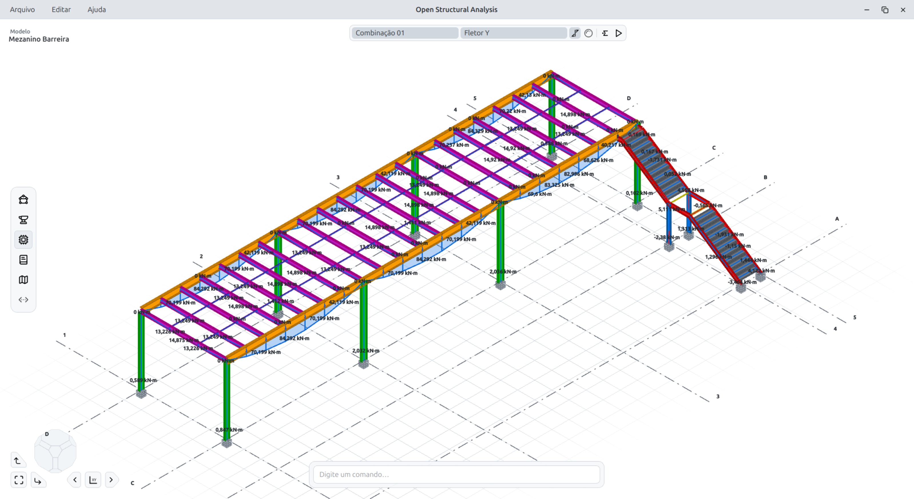

<p align="center">
  
</p>

<p align="center">Aplicação open source para modelagem e análise estrutural tridimensional</p>

<p align="center">
  <a href="https://www.python.org/"></a>
  <a href="https://github.com/jadirparreira/open-structural-analysis/releases/latest"></a>
  <a href="LICENSE"></a>
  <a href="https://github.com/jadirparreira/open-structural-analysis/releases/latest"></a>
  <a href="https://opensa.com.br"></a>
</p>

<p align="center">
  <a href="#sobre">Sobre</a> ·
  <a href="#recursos">Recursos</a> ·
  <a href="#instalacao">Instalação</a>
</p>



<a id="sobre"></a>
## Sobre

O **Open Structural Analysis (OpenSA)** é uma aplicação open source para criar, editar e analisar modelos estruturais tridimensionais em um único ambiente. A estrutura é construída com nós e barras, aos quais podem ser atribuídos materiais, seções, apoios, vínculos e ações. A cena 3D interativa ajuda a conferir a geometria, os eixos locais e as propriedades do modelo durante o trabalho.

O OpenSA permite organizar ações e combinações, processar a análise estrutural e consultar deslocamentos, reações de apoio e diagramas de esforços. Também oferece ferramentas para importar desenhos CAD como referência, exportar geometria e salvar os projetos em arquivos próprios. O aplicativo está em desenvolvimento ativo; recursos experimentais e rotinas de verificação têm escopo indicado abaixo e na documentação.

<a id="recursos"></a>
## Recursos

- **Modelagem 3D:** criação e edição de nós e barras; cópia de elementos e propriedades; divisão, união e inversão de barras; medição; e visualização da geometria e dos eixos locais.
- **Materiais e seções:** atribuição de materiais e seções às barras, usando os catálogos e as seções paramétricas disponíveis no programa.
- **Apoios e vínculos:** definição de restrições, apoios elásticos, liberações nas extremidades e ligações rígidas.
- **Ações e combinações:** organização de casos e grupos de ações, aplicação de cargas nodais e em barras, momentos e peso próprio, e configuração de combinações.
- **Análise estrutural:** processamento do modelo e visualização de deslocamentos, reações de apoio e diagramas de esforço normal, cortantes, momentos fletores e torção por combinação.
- **Verificações e memorial:** agrupamento de barras, rotinas de verificação disponíveis para barras de aço e visualização da taxa de utilização. O memorial de cálculo pode ser exportado em DOCX. A cobertura das verificações está em evolução, com hipóteses e limitações apresentadas pelo próprio programa.
- **Detalhamento:** criação de vistas para detalhamento de barras, alinhamento e conexão de extremidades, com exportação da vista 2D para DXF.
- **Referências CAD:** importação de desenhos DXF e DWG para consulta e captura de pontos durante a modelagem. As referências podem ser posicionadas nos planos XY, XZ ou YZ e ficam salvas no projeto.
- **Exportação DXF:** exportação do modelo e de vistas de detalhamento para uso em ferramentas CAD.
- **Organização da cena:** gerenciamento de vistas nomeadas e controle de visibilidade dos elementos no modelo.
- **Projetos e integração:** salvamento e abertura de projetos `.osa` e servidor MCP local opcional para consultar e operar o modelo com clientes compatíveis.

<a id="instalacao"></a>
## Instalação

### Versão de lançamento

Baixe a versão mais recente na página de [Releases](https://github.com/jadirparreira/open-structural-analysis/releases/latest). Escolha o instalador para Windows ou o AppImage para Linux e siga as instruções incluídas no pacote.

### Versão de desenvolvimento

Para executar o código-fonte, instale [Git](https://git-scm.com/downloads), [Python 3.10 a 3.13](https://www.python.org/downloads/) e [uv](https://docs.astral.sh/uv/). Clone a branch de desenvolvimento e instale as dependências:

```bash
git clone --branch ver5-dev https://github.com/jadirparreira/open-structural-analysis.git
cd open-structural-analysis
uv sync
```

Para habilitar a importação de DWG na execução pelo código-fonte, prepare o conversor local uma vez. No Linux, são necessários um compilador C e `make`:

```bash
uv run python scripts/prepare-dwg-converter.py
```

Execute o programa com:

```bash
uv run open-structural-analysis
```
