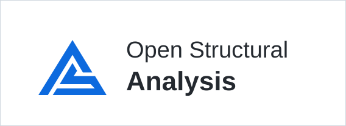
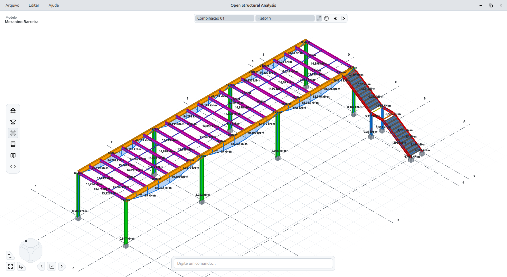

<p align="center">
  
</p>

<p align="center">Aplicação open source para modelagem e análise estrutural tridimensional</p>

<p align="center">
  <a href="https://www.python.org/"></a>
  <a href="https://github.com/jadirparreira/open-structural-analysis/releases/latest"></a>
  <a href="LICENSE"></a>
  <a href="https://github.com/jadirparreira/open-structural-analysis/releases/latest"></a>
  <a href="https://opensa.com.br"></a>
</p>

<p align="center">
  <a href="#sobre">Sobre</a> ·
  <a href="#recursos">Recursos</a> ·
  <a href="#instalacao">Instalação</a> ·
  <a href="#mcp">Assistentes de IA (MCP)</a>
</p>



<a id="sobre"></a>
## Sobre

O **Open Structural Analysis (OpenSA)** é uma aplicação open source para criar, editar e analisar modelos estruturais tridimensionais em um único ambiente. A estrutura é construída com nós, barras e placas, com definição de materiais, seções, apoios, vínculos e ações. A cena 3D interativa ajuda a conferir a geometria, os eixos locais e as propriedades do modelo durante o trabalho.

O OpenSA permite organizar ações e combinações, processar a análise estrutural e consultar deslocamentos, reações de apoio e diagramas de esforços de barras e placas. Também oferece ferramentas para importar desenhos CAD como referência, montar folhas de projeto com vistas e anotações, exportar desenhos e salvar os projetos em arquivos próprios. O aplicativo está em desenvolvimento ativo; recursos experimentais e rotinas de verificação têm escopo indicado abaixo e na documentação.

<a id="recursos"></a>
## Recursos

- **Modelagem 3D:** criação e edição de nós, barras e placas; cópia de elementos e propriedades; divisão, união e inversão de barras; medição; e visualização da geometria e dos eixos locais.
- **Materiais e seções:** catálogos de aço, concreto e madeira, seções paramétricas para barras e definição de espessura das placas. As placas usam um modelo homogêneo e isotrópico; as hipóteses dos materiais estão descritas no [catálogo de materiais](docs/material-catalog.md).
- **Apoios e vínculos:** definição de restrições, apoios elásticos, liberações nas extremidades e ligações rígidas.
- **Ações e combinações:** organização de casos e grupos de ações, aplicação de cargas nodais e em barras, ações nas superfícies e bordas das placas, momentos e peso próprio, e configuração de combinações.
- **Análise estrutural:** processamento integrado de barras e placas, com malha de elementos finitos, deslocamentos, reações de apoio e diagramas de esforços por combinação. Nas placas, inclui momentos Wood-Armer e tensões equivalentes de von Mises, com convenções e limites descritos na [documentação dos resultados de placas](docs/plate-postprocessing.md).
- **Verificações e memorial:** agrupamento de barras, rotinas de verificação disponíveis para barras de aço e visualização da taxa de utilização. O memorial de cálculo pode ser exportado em PDF (LaTeX), projeto `.tex` ou DOCX, e o laudo técnico da estrutura (comando `REPORT`) é gerado em LaTeX/PDF com deformadas desenhadas a partir dos resultados ([detalhes](docs/laudo-latex.md)). A cobertura das verificações está em evolução, com hipóteses e limitações apresentadas pelo próprio programa.
- **Detalhamento:** criação de vistas de barras, placas e componentes dos nós; cortes de seção, ajustes de extremidades e subtrações, com exportação da vista 2D para DXF.
- **Folhas de projeto:** composição de vistas e detalhes com cotas, textos, marcas de solda, imagens e tabelas, com exportação para PDF.
- **Referências CAD:** importação de desenhos DXF e DWG para consulta e captura de pontos durante a modelagem. As referências podem ser posicionadas nos planos XY, XZ ou YZ e ficam salvas no projeto.
- **Exportação DXF:** exportação do modelo e de vistas de detalhamento para uso em ferramentas CAD.
- **Organização da cena:** gerenciamento de vistas nomeadas e controle de visibilidade dos elementos no modelo.
- **Projetos e integração:** salvamento e abertura de projetos `.osa` e servidor MCP local opcional para consultar e operar o modelo com assistentes de IA como Claude e ChatGPT ([como instalar](#mcp)).

<a id="instalacao"></a>
## Instalação

### Versão de lançamento

Baixe a versão mais recente na página de [Releases](https://github.com/jadirparreira/open-structural-analysis/releases/latest). Escolha o instalador para Windows ou o AppImage para Linux e siga as instruções incluídas no pacote.

Os dois pacotes já incluem o conversor necessário para importar DWG e o compilador LaTeX (Tectonic) usado para gerar o laudo e o memorial em PDF.

### Versão de desenvolvimento

Para executar o código-fonte, instale [Git](https://git-scm.com/downloads), [Python 3.10 a 3.13](https://www.python.org/downloads/) e [uv](https://docs.astral.sh/uv/). Clone a branch de desenvolvimento e instale as dependências:

```bash
git clone --branch ver5-dev https://github.com/jadirparreira/open-structural-analysis.git
cd open-structural-analysis
uv sync
```

Execute o programa com:

```bash
uv run open-structural-analysis
```

#### Importação de DWG no desenvolvimento (opcional)

Para importar DWG ao executar pelo código-fonte, é necessário ter o conversor GNU LibreDWG disponível. Se ele ainda não estiver preparado no projeto, instalado como `dwg2dxf` no `PATH` ou indicado pela variável `OSA_DWG_CONVERTER`, execute uma vez:

```bash
uv run python scripts/prepare-dwg-converter.py
```

O script baixa e prepara o conversor. No Linux, são necessários um compilador C e `make`; no Windows de 64 bits, ele utiliza o executável oficial. Essa etapa é necessária apenas para importar DWG; o programa e a importação de DXF funcionam sem ela. Veja os [detalhes do suporte a DWG](docs/referencias-dxf.md#preparar-o-suporte-a-dwg-no-desenvolvimento).

#### Laudo e memorial em PDF no desenvolvimento (opcional)

O PDF do laudo e do memorial é compilado com o LaTeX instalado no sistema (`pdflatex`, `lualatex`, `xelatex` ou `tectonic` no `PATH`, como no MiKTeX ou no TeX Live) ou indicado pela variável `OSA_LATEX_ENGINE`. Sem nenhum deles, prepare uma vez o compilador Tectonic usado nos pacotes:

```bash
uv run python scripts/prepare-latex-engine.py
```

Na primeira compilação, o Tectonic baixa uma única vez os pacotes LaTeX usados. Sem compilador, o programa salva o projeto `.tex` com as figuras para compilar depois. Veja os [detalhes do laudo em LaTeX](docs/laudo-latex.md#compilação).
